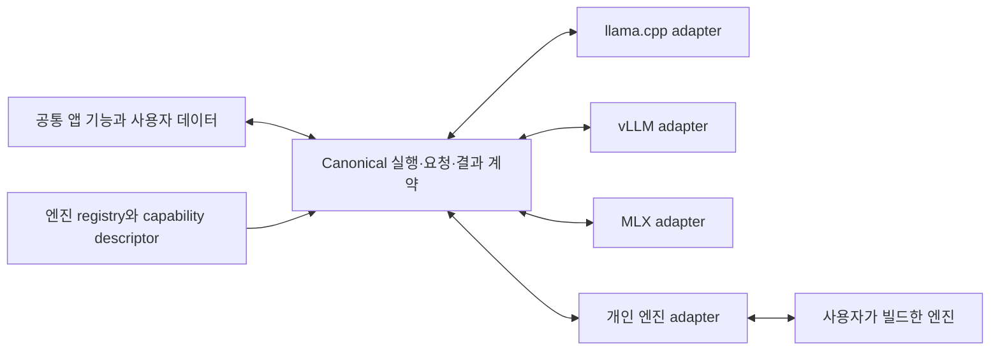

# 교체 가능한 추론 런타임 설계 방향

이 문서는 **장기 제품 방향과 제안 설계이며 아직 구현되지 않았다.** 현재 AioLM이 임의의 개인 추론 엔진·실행 파일·adapter manifest를 등록할 수 있다는 의미가 아니다. 이번 Mac 기기 검증·결함 수정과 별도로 구현해야 하며, 이 문서 추가로 현재 동작·기본값·공개 API를 바꾸지 않는다.

목표는 Chat, 모델 관리, 프로젝트·RAG, MCP, 프로필, 세션, gateway, 벤치마크의 공통 UX·기능 계약과 사용자 데이터를 유지하면서 추론 런타임 adapter만 교체하는 것이다. llama.cpp·vLLM·MLX뿐 아니라 사용자가 빌드한 개인 엔진도 AioLM 핵심 코드 수정이나 앱 재빌드 없이 등록할 수 있어야 한다. 엔진마다 다른 네이티브 기능을 동일하게 지원하는 것으로 표시하지는 않는다.

현재 구현과 운영 규칙은 [소스 아키텍처](architecture.md)와 [추론 런타임](inference-runtimes.md), 실제 기기 검증 절차는 [런타임 인계](provider-runtime-handoff.ko.md)와 [Mac 검증 결과](macos-device-validation-results.ko.md)를 따른다. 이 문서는 그 동작 설명이나 검증 결과를 대체하지 않는다.

## 현재 재사용할 경계와 제한

아래는 작성 시점 소스에 대한 관찰이다. 링크의 라인은 현재 구현의 위치이며 제안 API의 구현 근거가 아니다.

| 경계 | 이미 있는 기반 | 개인 엔진 확장을 제한하는 부분 |
| --- | --- | --- |
| 엔진·런타임 식별 | 공통 runtime inventory와 execution selection | [ProviderId와 고정 목록](../../src-tauri/src/providers/mod.rs#L37), [frontend ID](../../src/shared/api/providers.ts#L4), [EngineSelect](../../src/shared/ui/EngineSelect.tsx#L7)는 세 내장 엔진으로 닫혀 있다. |
| 외부 등록·실행 | 기존 Python 환경의 등록·probe·환경 보존 | [provider_register](../../src-tauri/src/commands/providers.rs#L47)는 Python 경로를 받고, [probe](../../src-tauri/src/providers/python_env.rs#L481)와 [launch](../../src-tauri/src/providers/launch.rs#L1049)는 vLLM/MLX 모듈로 고정돼 있다. [native 실행 경로](../../src-tauri/src/server.rs#L596)도 관리형 llama-server만 선택한다. |
| 공통 실행 계약 | [EngineCommand](../../src-tauri/src/providers/launch.rs#L965)의 program·argv·환경·readiness, [공통 spawn](../../src-tauri/src/server.rs#L901)의 소유 프로세스·로그 처리 | 비-llama 엔진을 Python으로 취급하는 분기를 runtime 종류와 adapter 선택으로 바꿔야 한다. |
| 모델·요청 | [ModelCompatibility](../../src-tauri/src/providers/compat.rs#L36), [EngineInfo](../../src-tauri/src/providers/protocol.rs#L21), [gateway lease](../../src-tauri/src/gateway/routing.rs#L297) | [artifact 검사](../../src-tauri/src/providers/execution.rs#L42), [호환성 분기](../../src-tauri/src/providers/compat.rs#L177), [요청 설정 목록](../../src/shared/config/providerRequestSettings.ts#L6)에 내장 엔진의 형식·옵션 가정이 남아 있다. |
| 프로필·설정 | provider별 옵션·최근 runtime·프로필 revision·적용 snapshot | [설정 검증](../../src-tauri/src/config.rs#L843)과 [프로필 검증](../../src-tauri/src/config/profiles.rs#L842)은 미등록 ID를 거부하고, [기본 프로필 생성](../../src-tauri/src/config/profiles.rs#L181)은 고정 목록을 순회한다. |
| 벤치마크 | 공통 실행·기록·CSV/XLSX와 정규화된 결과 | [워크로드 설정](../../src-tauri/src/performance_bench.rs#L202)과 [tokenizer·요청·context·cache 절차](../../src-tauri/src/performance_bench/providers.rs#L89)는 내장 엔진에 맞춰져 있다. [공개 runtime 이름](../../packages/benchmark-contracts/src/types.ts#L91)도 폐쇄형이다. |

현재 외부 Python 등록을 개인 엔진 plugin 등록으로 부르지 않는다. `ProviderId`에 문자열 하나를 추가하는 것만으로는 확장되지 않는다. 비-vLLM을 MLX로 취급하거나 미등록 ID를 llama.cpp로 대체하는 경로까지 함께 해소해야 한다.

## 제안하는 공통 경계 — 미구현

이 그림은 목표 구조다. 공통 기능은 engine ID 비교로 동작을 선택하지 않고 registry가 제공한 계약·capability를 사용한다. 내장 엔진도 같은 adapter 경계를 통과한다. adapter별 구현·내장 등록부·이전 코드에 필요한 기존 ID 처리는 유지하되, 새 엔진 추가를 위해 공통 기능에 전용 분기를 추가하지 않는다.

Registry는 표시 이름과 분리된 안정적인 opaque engine ID를 해석한다. engine ID, runtime instance ID, 실제 엔진 build/version, 모델 identity, 프로필 identity를 구분한다. 실행 파일 위치나 표시 이름 변경을 엔진 ID 변경으로 취급하지 않는다. 내장 ID와 다른 등록의 ID를 덮어쓰는 충돌은 거부한다.

Rust trait는 내부 adapter 구성에 사용할 수 있지만 그것만으로 개인 엔진 등록을 완성하지 못한다. 사용자 엔진은 **versioned manifest와 내장 protocol adapter**, 또는 **versioned out-of-process adapter**로 연결해야 한다. 후자는 엔진의 고유 protocol을 공통 계약으로 변환하는 별도 사용자 실행 프로그램이며 AioLM에 새 코드를 링크하지 않는다.

### 제안 등록·descriptor 계약 — 미구현

아래는 필요한 정보의 설계 범위다. 필드명·전송 방식·최종 schema는 구현 단계에서 확정하며, 현재 IPC/CLI에서 이 계약을 받는다고 해석하지 않는다.

| 정보 | 계약에 필요한 의미 |
| --- | --- |
| 계약 버전 | 등록 manifest, descriptor, adapter protocol의 버전을 구분한다. 지원하지 않는 필수 버전은 실행 전에 거부하고 원본 등록 정보는 보존한다. |
| 식별·플랫폼 | stable engine/runtime ID, 표시 이름, OS·architecture 조건, 실제 probe가 확인한 build/version·identity를 제공한다. |
| 실행·adapter | 사용자 선택 executable과 별도 argv, adapter 방식, working directory·필요한 환경 전달 규칙을 기술한다. native process를 Python으로 가정하지 않는다. |
| Probe | 설치 여부·실제 version·장치·옵션·task 근거를 구조화해 반환한다. 등록 기록만으로 영구 readiness를 부여하지 않으며 실행·측정 전 다시 검사한다. |
| 모델 | 지원 artifact 형식, 필요한 companion·tokenizer·processor, 모델 검사·호환성 결과와 근거를 제공한다. 파일 확장자만으로 loader 지원을 확정하지 않는다. |
| 옵션·bindings | 타입·범위·기본값의 출처, request/launch 적용 위치, restart 필요 여부, LoRA·draft·embedding 등 binding을 기술한다. 공통 editor·import·preview·backend 검증이 같은 schema를 사용한다. |
| 기능·지표 | task·modality·tools·tokenizer·benchmark·deep verification·portable 기능별 지원 상태와 이유, 측정값의 단위·범위·방법을 제공한다. |

등록 manifest는 사용자가 선택한 환경을 참조한다. 등록 제거는 외부 실행 파일·모델·환경을 삭제하지 않는다. 앱이 관리하는 설치나 임시 자원과 외부 자원의 소유권은 명시적으로 구분한다. 기본값은 engine의 검증된 schema·기존 제품 정책에서 얻으며 개발 기기의 설정을 복사하지 않는다.

### 실행·readiness·소유권

Adapter는 선택된 모델·설정과 앱이 할당한 loopback port·모델 alias·자격 증명으로 구조화된 launch 계획을 만든다. 옵션이 앱 소유 binding을 덮어쓰지 못하도록 검증한다. credential은 command preview·공개 provenance·로그에 포함하지 않는다.

공통 lifecycle이 엔진과 adapter의 소유 child/process group·Windows job, port, 로그, 임시 credential·media·staging을 추적한다. 준비 실패·취소·재시작·정상 종료 때 그 소유 자원을 정리하며 외부 환경과 원본 파일은 보존한다. readiness는 단순한 port 응답이 아니라 실행한 process의 listener와 예상 모델·task를 확인해야 한다. active request/stream의 lease와 취소 의미를 유지하며 API listener와 모델 lifecycle도 계속 분리한다.

기존 모델을 중지하기 전의 probe·모델·옵션 검증이 실패하면 기존 실행을 보존한다. 기기 메모리 제약 때문에 두 엔진의 동시 running을 전제하지 않는다. 기존 모델을 중지한 뒤 새 모델의 실제 loading이 실패하면 이전 선택·설정과 실패 진단을 보존하고 명시적인 복구 경로를 제공한다. 기존 실행이 계속 유지된 것으로 표시하거나 알 수 없는 엔진을 llama.cpp로 자동 대체하지 않는다.

## 공통 기능과 engine-native capability

지원 여부는 engine 이름만으로 결정하지 않는다. 설치 probe, 선택 모델·bindings, protocol 구현을 해석한 **model-resolved capability**가 task·modality·tools의 사용 가능 여부를 결정한다. 지원, 명시적 미지원, 아직 확인되지 않음과 readiness 문제를 구분하고 근거·이유를 표시한다. 미확인 값을 지원으로 승격하지 않는다.

- **모델 관리:** GGUF·safetensors 등 형식 registry와 adapter의 loader 검사를 분리한다. GGUF는 형식이며 특정 engine 선택과 동의어가 아니다. 같은 공통 기능·계약을 유지해도 동일한 weights 파일이 모든 엔진과 호환되는 것은 아니며 실제 형식·모델 지원은 loader capability로 확인한다. 개인 엔진의 새로운 형식도 registry/adapter를 통해 검사할 수 있어야 한다. app-owned 다운로드 manifest, 불완전 상태, 삭제 보호와 외부 파일 보존 계약을 유지한다.
- **Chat·gateway:** canonical 요청·결과는 message, reasoning, tool-call ID/arguments, 모델 alias, task, media, error, authoritative usage와 종료 이유를 보존한다. 내장 protocol 또는 별도 adapter가 엔진 요청·SSE를 변환한다. chunk 경계·UTF-8·취소·정상 종료·중간 오류의 의미를 유지하며 gateway의 기존 공개 wire API를 보존한다.
- **프로젝트·RAG·MCP:** 프로젝트·인용·문서 index·승인/거부/취소·재시도 기능은 공통 계층에 남긴다. 별도 task의 embedding runtime을 명시적으로 연결할 수 있어야 하며, 기존 keyword 검색 정책을 유지한다. 도구를 지원하지 않는 답변 모델에서는 이유를 알리고 tool 요청을 거부한다. tool 정의나 후속 응답을 조용히 제거하지 않는다.
- **미디어 전처리:** 문서 추출·로컬 영상 frame 추출·media 보관·취소는 host 서비스다. STT는 사용자가 연결한 별도 transcription runtime을 이용할 수 있다. 답변 runtime과 전처리 runtime을 구분하고, 저장된 transcript/frame·원본 참조를 재로드·재시도에서 재사용한다. 지원하지 않는 입력을 임의로 텍스트로 바꾸거나 엔진을 자동 교체하지 않는다.
- **프로필·세션:** 공통 선택·저장·revision·적용 snapshot·기록은 유지한다. engine별 옵션과 runtime/model binding을 구분하고, 다른 engine의 옵션을 새 engine으로 전달하지 않는다. 실행 중 세션 identity가 저장된 이전 선택보다 우선한다.

**모델 loadability와 chat-template 지원은 별도다.** GGUF나 다른 base 모델을 로드하고 text completion이 가능해도 chat template가 없으면 chat 요청은 사용할 수 없을 수 있다. 모델 파일의 template와 실제 loader가 선택한 tokenizer/processor의 template도 구분한다. 임의 template나 다른 모델을 기본 복구값으로 넣지 않으며, 확인된 limitation과 필요한 사용자 선택을 안내한다.

## 지표·벤치마크·검증·portable 계약

공통 화면·이력·CSV/XLSX는 유지한다. Adapter는 제공한 값, 명시적 미지원, 미제공/미확인을 구분하고 값의 방법·단위·범위를 전달한다. authoritative prompt/completion usage와 추정 token 수, engine phase 시간과 client 관측 시간, process-group RSS와 device/unified memory를 섞지 않는다. 미제공 값을 0이나 성공으로 채우지 않으며 TTFT를 PP phase 시간으로 대체하지 않는다.

| 기능 | adapter가 제공해야 하는 근거와 미지원 처리 |
| --- | --- |
| Serving benchmark | 격리된 같은 엔진·모델 실행, 정확한 tokenizer/요청 길이, 실제 context/concurrency 확인, 입증된 cold-cache 절차, authoritative usage, client timing과 소유 process RSS. 지원이 없으면 해당 측정의 이유를 표시하고 가짜 결과를 만들지 않는다. |
| Deep verification | 실제 장치와 reference의 비교 방법·coverage·fingerprint·결과를 제공한다. partial을 full pass로 바꾸지 않고 reference를 제공할 수 없으면 명시적으로 미지원/미확인으로 남긴다. 기존 실패·override는 정확히 같은 조합에만 적용한다. |
| Portable | 해당 runtime 종류의 재현 가능한 binary/dependency·hash·OS/architecture/ABI 계약과 새 환경 import/probe를 제공한다. 일반 개인 실행 파일을 Python wheel bundle로 간주하지 않는다. adapter가 이 기능을 제공하지 않으면 registration과 구분해 미지원으로 표시한다. |

일반적인 OpenAI chat 응답만 제공하는 개인 엔진은 Chat을 연결할 수 있어도 위 benchmark/deep/portable 능력을 자동으로 갖지 않는다. 공통 기능 코드와 데이터 형식은 유지하고 실행 가능한 부분과 불가능한 부분을 capability로 설명한다. 실제 검증 상태는 기존 `pass / fail / unsupported / unrun / blocked` 의미를 유지하며 실패를 skip으로 통과시키지 않는다.

## API·데이터 호환성

제안 구현은 frontend/native engine ID와 catalog·runtime/engine info를 확장하고, 새로운 manifest 등록·probe·adapter 계약을 추가해야 한다. 기존 Python 등록 IPC/CLI와 manifest는 계속 읽을 수 있게 유지한다. `is_python = non-llama` 같은 판정은 descriptor의 runtime 종류로 옮기며 공통 API가 개인 엔진을 내장 engine 이름으로 위장하지 않는다.

- 기존 `llama.cpp`, `vllm`, `mlx-vlm` ID와 해당 options, runtime 선택, 프로필·적용 revision, system prompt, 대화·프로젝트·세션·벤치마크 원문 의미를 보존한다. 과거 provider 누락 값이 llama.cpp라는 이전 규칙도 유지한다.
- nonempty 미등록 ID를 llama.cpp로 fallback하지 않는다. adapter가 제거되었거나 offline이어도 해당 설정·옵션·프로필·기록을 보존하고 unavailable로 표시한다. adapter 재등록 후 저장된 선택을 복구할 수 있어야 한다.
- 이전은 versioned·원자적으로 수행하고 원본 backup을 보존한다. 미래 schema/adapter 버전은 무손실 보존·명시적 거부 규칙을 가지며, 오래된 앱이 새 데이터를 다시 써서 잃지 않도록 검증한다.
- 공개 benchmark schema 1/2와 기존 의미는 바꾸지 않는다. 개인 엔진의 공개 projection이 필요하면 별도 versioned 계약과 수신 서비스 지원을 먼저 추가한다. 그 전에는 로컬 기록을 보존하며 기존 이름으로 위장하거나 공개 upload를 활성화하지 않는다.

## 구현 전환 순서와 수락 기준

1. 기존 세 엔진·설정 이전·공개 schema 1/2의 계약을 고정하고 registry/descriptor와 version 협상 경계를 추가한다. 내장 ID의 저장·wire 표현은 유지한다.
2. 내장 엔진의 probe·모델/옵션 검사·launch·protocol·benchmark 등 분기를 adapter로 옮긴다. 기존 기능 controller와 데이터 계약의 변화를 최소화하고 Windows/Linux 공통 검사를 통과시킨다.
3. 합성 네 번째 엔진을 manifest로 등록한다. 내장 protocol과 out-of-process 변환 경로를 확인하며, 공통 feature/lifecycle 코드에 새 engine-specific branch를 추가하지 않고 전체 여정을 검사한다.
4. 실제 사용자 빌드 엔진을 별도 테스트 환경에서 등록·probe·실제 추론한다. 정확한 source/build identity와 모델 revision을 고정하고 선언한 capability를 실제 입력·응답으로 검증한다.

| 수락 항목 | 필요한 확인 |
| --- | --- |
| 앱 재빌드 없는 교체 | 고정된 AioLM binary에 합성 네 번째 엔진과 실제 개인 build를 등록·선택·재시작·제거/재등록한다. 앱 핵심 코드 수정 없이 catalog·옵션·모델 호환성·live identity가 반영된다. |
| 공통 기능·데이터 | Chat stream·reasoning·취소·retry·기록 재로드, 프로젝트·RAG의 명시적 embedding 연결, STT 전처리 연결, MCP 승인/거부/취소/후속 응답, 프로필·multi-session·gateway routing을 지원 범위대로 실행한다. 미지원 입력/기능은 명확히 거부하며 원본 데이터·다른 엔진 선택을 보존한다. |
| 기능 코드 경계 | 새 엔진 ID 비교·전용 옵션/모듈/endpoint 가정이 공통 앱 기능과 lifecycle에 추가되지 않는다. 이런 처리는 adapter·descriptor·내장 등록부에만 존재하며 정적 검토/검사로 확인한다. |
| 계약·측정 | arbitrary SSE chunk·중간 오류·template 없음·미지원 media/tools·누락 usage/PP·잘못된 context/cache 응답을 합성 검사한다. 실제 benchmark는 정확한 usage와 cold-cache 근거를 요구하고 unsupported/partial을 전체 pass로 계산하지 않는다. |
| Round trip·복원 | 기존 세 엔진 설정/프로필/세션/이력과 schema 1/2의 read/save/export/import 의미를 유지한다. 개인 등록·설정의 round trip, adapter 부재/offline·미래 버전·충돌 시 값 보존, 지원하는 portable의 새 환경 import 후 실제 추론을 확인한다. |
| Cleanup·플랫폼 | 등록/준비/실제 loading/stream/benchmark/import의 실패·취소·재시작·종료 때 소유 process/port/staging 정리와 외부 환경·기존 출력 보존을 확인한다. Windows/Linux 계약·프로세스 소유권·경로/argv 검사와 해당 엔진이 선언한 플랫폼의 실제 실행을 구분한다. |

구현 완료는 이 문서나 합성 엔진 한 개의 성공으로 선언하지 않는다. 기존 세 엔진의 영향받은 실제 여정과 개인 엔진의 선언된 기능을 검증하고, 실행하지 못한 범위·실제 실패·upstream 제한을 근거와 함께 남긴다.
